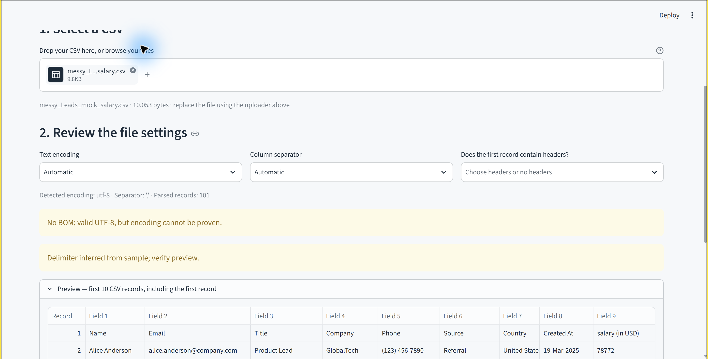
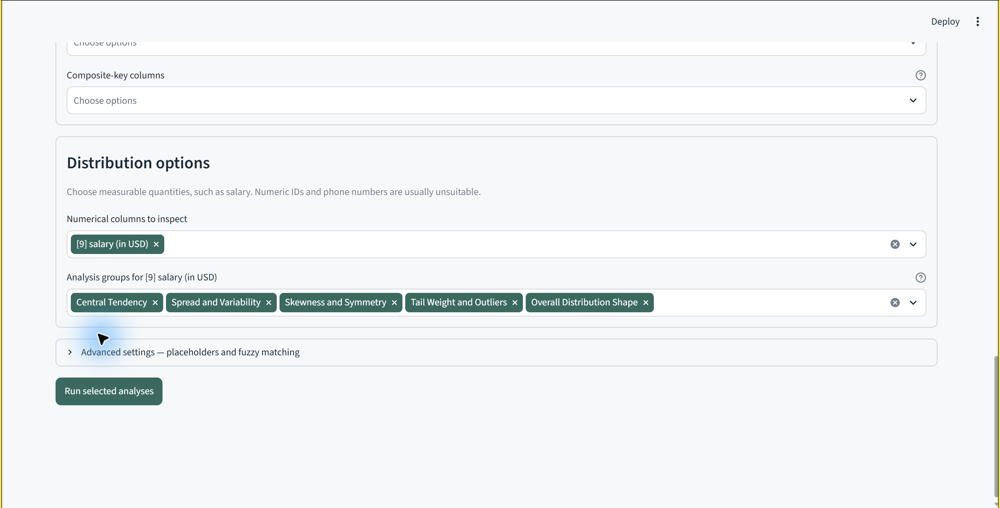
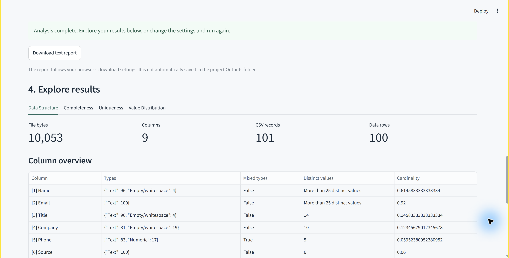
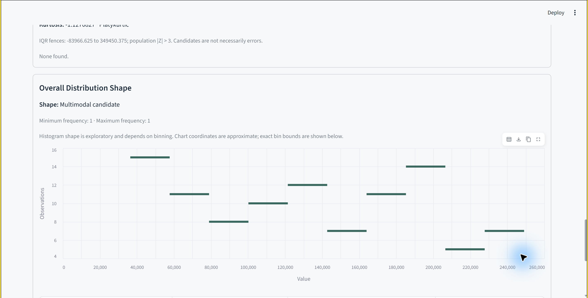
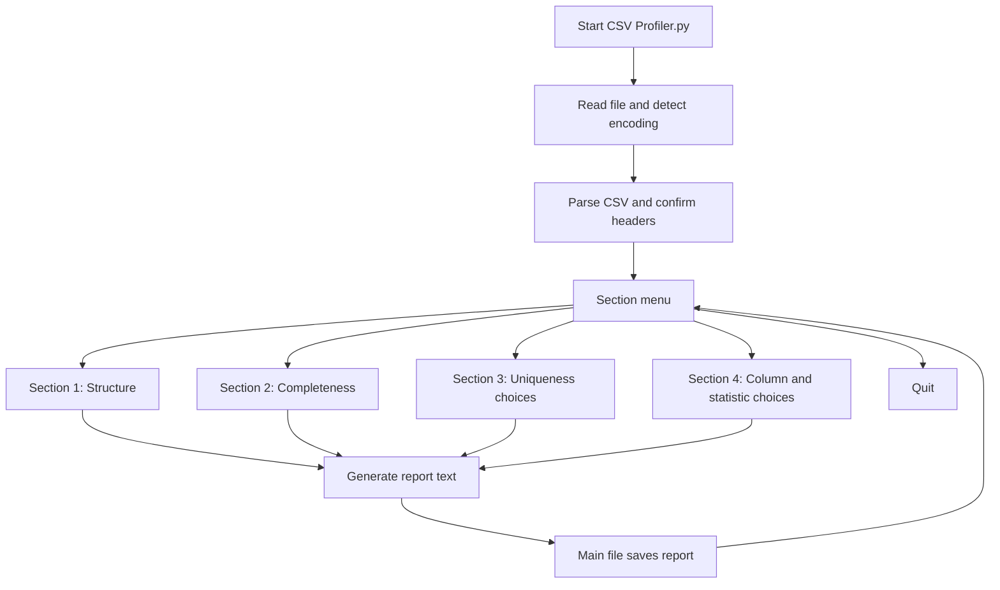

# CSV Profiler

Profile a CSV without changing its contents. The terminal version needs only Python; the optional visual version adds Streamlit.

## Visual walkthrough

This walkthrough profiles the local synthetic `messy_Leads_mock_salary.csv` fixture: 100 mock lead records across nine fields. The CSV itself stays outside the repository; the screenshots show the complete workflow without publishing input data.


### 1. Upload and verify the file

The app detects the encoding and separator, reports the record count, and previews the raw fields before analysis.



### 2. Choose the checks

Select structure, completeness, uniqueness, and value-distribution checks. Here, the salary column is configured for all five statistical groups.



### 3. Review the data profile

The results summarize file dimensions and show inferred types, mixed-type flags, distinct values, and cardinality for each column.



### 4. Inspect the salary distribution

The value-distribution tab reports summary statistics, outlier checks, and an exploratory histogram. The text report can then be downloaded from the browser.



## Visual interface (local browser)

Requires Python 3.11 or later. Download/extract the project, then open a terminal in its folder.

One-time Windows setup:

```powershell
python -m venv .venv
.venv\Scripts\python.exe -m pip install -r requirements-visual.txt
```

Start the visual interface:

```powershell
.venv\Scripts\python.exe -m streamlit run visual_app.py --server.address 127.0.0.1 --browser.gatherUsageStats false
```

After setup, you can instead double-click **Start Visual Profiler.cmd** on Windows. Keep its terminal open while using the app. Press Ctrl+C in the terminal to stop the server; closing the browser tab alone does not stop it.

1. Drop/select a CSV. Try `Examples/demo_leads.csv`, which contains entirely synthetic data.
2. Review the preview, encoding and separator; choose whether the first record contains headers, then click **Continue to analysis options**.
3. Select sections. Configure optional uniqueness checks and per-column distribution groups using clickable controls.
4. Click **Run selected analyses**. Explore the result tabs and tables.
5. Click **Download text report**. The file goes to your browser's download location, rather than the terminal's Outputs directory.

Files are processed by a local Python server on your computer, not uploaded to GitHub or an external profiling service. Usage telemetry is disabled in the supplied configuration/launcher. No file is edited. The visual uploader allows files up to 50 MB; processing is still in memory, and this limit does not guarantee every analysis will be fast. Changing file/settings hides outdated results until you rerun. Advanced settings control placeholders and fuzzy defaults.

macOS/Linux setup and launch:

```bash
python3 -m venv .venv
.venv/bin/python -m pip install -r requirements-visual.txt
.venv/bin/python -m streamlit run visual_app.py --server.address 127.0.0.1 --browser.gatherUsageStats false
```

Those commands are provided for portability; Windows is the verified environment. This is a source release requiring Python, not a standalone executable. Setup needs internet; installed app assets and profiling work locally.

Run all tests, including optional visual workflow tests:

```powershell
.venv\Scripts\python.exe -m unittest -v
```

## Terminal version

The terminal version requires no additional packages and still works independently of the visual dependencies.

## Run

Open a PowerShell terminal in this project folder, then paste:

```powershell
python "CSV Profiler.py"
```

When asked for the CSV path, enter a full path or a project-relative path, for example:

```text
Input Data\messy_leads.csv
```

1. Review the first record and enter `y` if it contains column headers, otherwise `n`.
2. Choose sections: `1` Structure, `2` Completeness, `3` Uniqueness, or `4` Value Distribution. For multiple sections, enter something like `1,2,3,4`.
3. Section 3 asks for identifier methods, optional grouping, and composite keys. Section 4 asks for columns, then one or more analysis groups per column (or `all`). Leave optional selections blank to skip them.
4. Open the generated text report in `Input Data/Outputs/`.
5. Choose another section from the menu, or enter `q` to quit. Repeat exports receive numbered filenames.

## Copy-and-paste examples

Start with the sample CSV already selected:

```powershell
python "CSV Profiler.py" "Input Data\messy_leads.csv"
```

Run Sections 1 and 2 once, treating the first record as headers, then exit:

```powershell
python "CSV Profiler.py" "Input Data\messy_leads.csv" --header yes --sections 1,2
```

An explicit `--sections` run refuses to overwrite an existing report. To choose a new report filename:

```powershell
python "CSV Profiler.py" "Input Data\messy_leads.csv" --header yes --sections 2 --output "Input Data\Outputs\completeness-review.txt"
```

Run automated tests:

```powershell
python -m unittest -v
```

## Workflow



The diagram shows interactive runs. Runs using `--sections` exit after saving.

Fuzzy matching uses similarity 85/100 and a 100,000-pair limit automatically. Optional overrides:

```powershell
python "CSV Profiler.py" --fuzzy-threshold 90 --fuzzy-limit 200000
```

Section 4 groups: Central Tendency; Spread and Variability; Skewness and Symmetry; Tail Weight and Outliers; Overall Distribution Shape. Every statistic in a selected group runs after the numeric applicability check.

## Terminal input rules

- Numbered menus accept `2` or `1,3`; `1, 3` also works. Any order is accepted and repeated numbers count once. Use commas, not spaces alone.
- Enter skips only optional prompts; required prompts explain what to enter.
- Enter `all` only when the prompt offers it (Section 4 groups).
- Section 3 method choices are `1` Exact, `2` Fuzzy, `3` Both. Grouping takes one column; composite keys take at least two distinct columns.
- Enter `back` during section configuration to discard unfinished choices and return to the section menu. Enter `q` at any prompt to quit.
- Missing file paths can be corrected without restarting. Paths with spaces may have matching surrounding single or double quotes.
- Reports are saved after configuration; the program then explains that it is returning to the menu. `--sections` runs exit after saving.

The terminal and visual interfaces use the same structured analysis results and text report formatter.

## Sharing on GitHub

Keep real CSVs, generated reports, `.venv`, and caches out of commits (the supplied `.gitignore` covers the normal locations). Only `Examples/demo_leads.csv` is intended as a public synthetic example. Ignoring a file does not remove one already committed; review the files before publishing. No hosting/account is required to run the local app.
